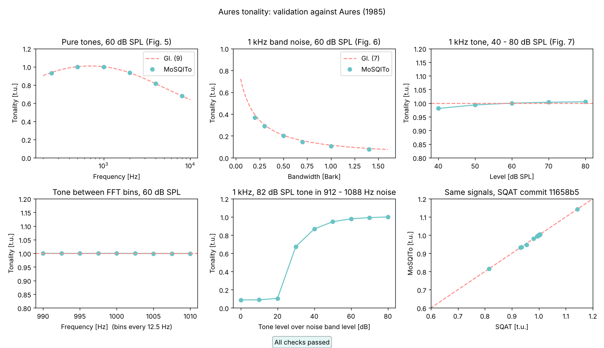

# Aures tonality: validation

Status: **experimental**, first implementation of this metric in MoSQITo.

## What is implemented

| | |
|---|---|
| Function | `mosqito.sq_metrics.tonality_aures(signal, fs, field_type="free")` |
| Metric and quantity | Tonality K (Klanghaftigkeit) in tonality units [t.u.] of a stationary sound, one value per signal |
| Paper | W. Aures, "Berechnungsverfahren für den sensorischen Wohlklang beliebiger Schallsignale", Acustica 59 (1985) 130-141, section 2.3, Gl. (7) to (13), Fig. 8 |
| Component extraction, masking slopes, threshold in quiet | E. Terhardt, G. Stoll, M. Seewann, J. Acoust. Soc. Am. 71 (1982) 679-688, doi:10.1121/1.387544 |
| Weighting | The original weights of Aures (w1 enters Gl. (11) with the exponent 1/0.29). The modified weights of Estreder et al. (2023, doi:10.1016/j.apacoust.2023.109238) are **not** used; their paper served as a cross-check of the equations. |
| Reference | 1 kHz pure tone, 60 dB SPL = 1 t.u. (Aures, p. 137) |
| Code | written from the papers; no code of another implementation was ported |

## Conventions that change the numbers

| Convention | Value | Where |
|---|---|---|
| Input | pascals; the user calibrates | `signal` |
| Sampling rate | any; the Zwicker loudness fills the bands above fs/2 with zeros | |
| Spectrum | Welch, Hamming window, segments of fs/12.5 samples (80 ms at 48 kHz), 50 % overlap, averaged over the whole signal, spacing 12.5 Hz | `_spectrum` |
| Search range of the components | 20 Hz to fs/2 (Terhardt's pitch analysis stops at 5 kHz; Fig. 5 of Aures goes to 8 kHz) | `F_MIN` |
| Sound field of the loudness | free (parameter `field_type`, ISO 532-1 stationary method) | `field_type` |
| Calibration constant c of Gl. (13) | computed so that the reference tone gives exactly 1 t.u.: 1.1055 at 48 kHz | `_calibration_constant` |
| Upper limit of K | none (Fig. 9 of Aures shows computed values up to 1.2) | |
| Time | one value for the whole signal; segment the signal yourself for time-varying sounds | |

## Choices where the paper is silent

* A sinusoid is a Terhardt peak whose -3 dB width (parabola through the three central lines in dB) does not exceed 1.8 bins; the main lobe of the window is 1.3 bins wide. Wider peaks go to the narrowband search.
* Frequency and level of a sinusoid come from the main-lobe shape of the window (the level difference of the two neighbouring lines gives the position between the bins, the position gives the scalloping loss). The leakage of each sinusoid is subtracted from the spectrum before the noise is read.
* Narrowband regions (section 2.3.2): the maxima of the residual smoothed over 3 bins are visited in order of level; the floor around a maximum is the median level of the surrounding critical bands (0.5 to 1.5 Bark away); the region is the run of bins more than 6 dB above that floor; its level is the power above the floor, its centre the power centroid, its bandwidth the second-moment width (sqrt(12) sigma) of the power above the floor, less the width of the window's main lobe. The critical band of the region must be 7 dB above the critical bands next to its edges. Regions up to 1.5 Bark are accepted: Fig. 6 of Aures follows Gl. (7) up to 1.4 Bark.
* Bark scale and critical bandwidth: the analytic forms of Zwicker and Terhardt (1980), as in Terhardt et al. (1982).

## Known limitations

* Components narrower than about 25 Hz cannot be told from sinusoids at the 12.5 Hz resolution and get w1 = 1.
* Below 40 dB SPL the tonality of a pure tone decreases through w3 (the level excess over the threshold in quiet gets small): 0.954 t.u. at 30 dB. Aures validated the level independence between 2 and 28 sone (Fig. 7).
* Stationary sounds only.

## Validation against Aures (1985)

All signals are generated by `tonality_aures_validation.py` (48 kHz, 2 s, zero-phase sinusoids and FFT-limited Gaussian noise); no external data is needed. Targets are the equations of the paper. Run `python validations/sq_metrics/tonality_aures/validation_tonality_aures.py` from the repository root to print the tables and draw `output/validation_tonality_aures.png`.

### Reference tone and tone between two bins

| Signal | Source of the target | Target | Obtained | Deviation | Tolerance | Pass |
|---|---|---|---|---|---|---|
| 1 kHz, 60 dB SPL | Aures 1985 p. 137 | 1.000 | 1.000 | -0.000 | 0.001 | yes |
| 990 to 1010 Hz in steps of 2.5 Hz, 60 dB SPL (9 tones) | same as 1 kHz | 1.000 | 0.999 to 1.000 | -0.001 | 0.010 | yes |

### Frequency dependence of pure tones (Fig. 5, Gl. 9)

| Signal | Source of the target | Target | Obtained | Deviation | Tolerance | Pass |
|---|---|---|---|---|---|---|
| 250 Hz, 60 dB SPL | Gl. (9) / Fig. 5 | 0.937 | 0.932 | -0.004 | 0.050 | yes |
| 500 Hz, 60 dB SPL | Gl. (9) / Fig. 5 | 1.001 | 0.999 | -0.001 | 0.050 | yes |
| 1000 Hz, 60 dB SPL | Gl. (9) / Fig. 5 | 1.000 | 1.000 | -0.000 | 0.050 | yes |
| 2000 Hz, 60 dB SPL | Gl. (9) / Fig. 5 | 0.934 | 0.935 | +0.001 | 0.050 | yes |
| 4000 Hz, 60 dB SPL | Gl. (9) / Fig. 5 | 0.813 | 0.815 | +0.002 | 0.050 | yes |
| 8000 Hz, 60 dB SPL | Gl. (9) / Fig. 5 | 0.679 | 0.679 | -0.000 | 0.050 | yes |

### Bandwidth dependence of narrowband noise (Fig. 6, Gl. 7)

| Signal | Source of the target | Target | Obtained | Deviation | Tolerance | Pass |
|---|---|---|---|---|---|---|
| 1 kHz band noise, dz = 0.2 Bark (31 Hz), 60 dB SPL | Gl. (7) / Fig. 6 | 0.394 | 0.368 | -0.026 | 0.059 | yes |
| 1 kHz band noise, dz = 0.3 Bark (47 Hz), 60 dB SPL | Gl. (7) / Fig. 6 | 0.302 | 0.291 | -0.012 | 0.045 | yes |
| 1 kHz band noise, dz = 0.5 Bark (78 Hz), 60 dB SPL | Gl. (7) / Fig. 6 | 0.206 | 0.201 | -0.005 | 0.031 | yes |
| 1 kHz band noise, dz = 0.7 Bark (110 Hz), 60 dB SPL | Gl. (7) / Fig. 6 | 0.157 | 0.147 | -0.010 | 0.023 | yes |
| 1 kHz band noise, dz = 1.0 Bark (157 Hz), 60 dB SPL | Gl. (7) / Fig. 6 | 0.115 | 0.105 | -0.010 | 0.017 | yes |
| 1 kHz band noise, dz = 1.4 Bark (220 Hz), 60 dB SPL | Gl. (7) / Fig. 6 | 0.085 | 0.079 | -0.006 | 0.013 | yes |

The obtained values sit 4 to 9 % under the curve because a little of the noise band stays outside the extracted region and lowers w_Gr (0.93 to 0.94 instead of 1).

### Level independence (Fig. 7)

| Signal | Source of the target | Target | Obtained | Deviation | Tolerance | Pass |
|---|---|---|---|---|---|---|
| 1 kHz, 40 dB SPL | Fig. 7 | 1.000 | 0.981 | -0.019 | 0.030 | yes |
| 1 kHz, 50 dB SPL | Fig. 7 | 1.000 | 0.993 | -0.007 | 0.030 | yes |
| 1 kHz, 60 dB SPL | Fig. 7 | 1.000 | 1.000 | -0.000 | 0.030 | yes |
| 1 kHz, 70 dB SPL | Fig. 7 | 1.000 | 1.003 | +0.003 | 0.030 | yes |
| 1 kHz, 80 dB SPL | Fig. 7 | 1.000 | 1.005 | +0.005 | 0.030 | yes |

### Noise and tone in noise

| Signal | Source of the target | Target | Obtained | Deviation | Tolerance | Pass |
|---|---|---|---|---|---|---|
| white noise 20 Hz - 20 kHz, 60 dB SPL | Aures section 2.3.2 | 0.000 | 0.000 | +0.000 | 0.020 | yes |

A 1 kHz, 82 dB SPL tone in Gaussian noise one critical band wide (912 to 1088 Hz); the tonality has to rise with the level of the tone over the noise band (trend check, no target value in the paper):

| Tone over noise band [dB] | Noise band [dB SPL] | Tonality [t.u.] |
|---|---|---|
| 0 | 106 | 0.088 |
| 10 | 96 | 0.089 |
| 20 | 86 | 0.104 |
| 30 | 76 | 0.674 |
| 40 | 66 | 0.867 |
| 50 | 56 | 0.947 |
| 60 | 46 | 0.979 |
| 70 | 36 | 0.993 |
| 80 | 26 | 1.000 |

With the tone 0 to 20 dB over the band it is masked; the 0.09 t.u. is the noise band itself, which is about 1.1 Bark wide and counts as a narrowband component with w1 = 0.11 (Gl. 7).

## Comparison with an independent implementation (SQAT)

SQAT (G. Felix Greco, R. Merino-Martínez, A. Osses, M. J. B. Lotinga, doi:10.5281/zenodo.7934709), `psychoacoustic_metrics/Tonality_Aures1985/Tonality_Aures1985.m` at commit `11658b5` of `main` (2026-10-02), MATLAB R2026a, GPL-3.0, a different lineage (AARAE / Terhardt code of 2020, revised in 2026). SQAT works on 250 ms Hann frames with 125 ms hop and gives a time series; the mean over the frames of a stationary signal is compared with our single value. The signals are generated by the same formulas on both sides (`comparison_sqat/compare_sqat_aures.m` on the MATLAB side, `tonality_aures_validation.compare_with_sqat` on ours): sums of zero-phase sinusoids, and, for narrowband noise, multisines with 1 Hz line spacing and pseudo-random phases from a Park-Miller generator, which is exact in double precision in both languages. Phases linear in the line index (a golden-ratio sequence, for instance) would make a pulse train, which a frame-wise analysis reads very differently from the long-term spectrum; the generator phases keep the signal stationary at the frame scale. SQAT's results are kept in `input/sqat_aures_results.csv`.

| Case | Signal | SQAT | MoSQITo | Difference |
|---|---|---|---|---|
| ref | 1000 Hz 60 dB | 1.000 | 1.000 | -0.000 |
| bin_1003 | 1003 Hz 60 dB | 1.000 | 1.000 | -0.000 |
| bin_1006.25 | 1006.25 Hz 60 dB | 1.000 | 0.999 | -0.001 |
| bin_1009 | 1009 Hz 60 dB | 1.000 | 0.999 | -0.000 |
| two_A | 1000 Hz 60 dB + 1500 Hz 30 dB | 1.004 | 1.004 | -0.000 |
| two_B | 1000 Hz 60 dB + 1200 Hz 40 dB | 0.997 | 0.997 | -0.000 |
| three | 500 + 1000 + 2000 Hz, 50 dB each | 1.142 | 1.142 | -0.000 |
| level_40 | 1000 Hz 40 dB | 0.981 | 0.981 | -0.000 |
| level_50 | 1000 Hz 50 dB | 0.994 | 0.993 | -0.000 |
| level_70 | 1000 Hz 70 dB | 1.003 | 1.003 | -0.000 |
| level_80 | 1000 Hz 80 dB | 1.005 | 1.005 | -0.000 |
| freq_250 | 250 Hz 60 dB | 0.932 | 0.932 | +0.000 |
| freq_500 | 500 Hz 60 dB | 0.999 | 0.999 | -0.000 |
| freq_2000 | 2000 Hz 60 dB | 0.935 | 0.935 | -0.000 |
| freq_4000 | 4000 Hz 60 dB | 0.815 | 0.815 | -0.000 |
| lcg_band | multisine 961-1040 Hz 60 dB, LCG phases | 0.215 | 0.189 | -0.026 |
| lcg_tone_26dB | 1000 Hz 82 dB + multisine 912-1088 Hz 56 dB, LCG phases | 0.954 | 0.946 | -0.008 |
| lcg_tone_6dB | 1000 Hz 82 dB + multisine 912-1088 Hz 76 dB, LCG phases | 0.183 | 0.667 | +0.484 |

Both implementations calibrate c from the reference tone and arrive at 1.1055, and they agree on every signal made of sinusoids and on narrowband noise alone (`lcg_band`, a 0.5 Bark band: 0.215 against 0.189, Gl. (7) gives 0.206). They part on a tone in narrowband noise, and the `lcg_tone_*` signals show where. The narrowband regions of SQAT follow the geometry of FindBand_V in Hastings (2004): the noise floor is the lowest level of the smoothed spectrum within half a critical band beyond the half-power points, the region extends out to that point, and the whole region is replaced by a line between its ends. For a tone inside a band of noise narrower than that reach, the lowest point lies outside the band, so band and tone become one region and the band is bridged away: it enters neither E_Gr of Gl. (8) nor N_Gr, the level excess of the tone reads 78 dB and 66 dB where the tone stands 26 dB and 6 dB over the band, and the width of the region grows with the share of the noise in it (Δz = 0.008 and 0.32 Bark), which is where SQAT's K falls (0.954 and 0.183). This implementation follows Fig. 8 of the paper, sinusoids first and regions in the residual: the tone keeps Δz = 0, the band enters E_Gr as Gl. (8) states (level excess 26 dB and 6 dB), and K follows w3 (0.947 and 0.667). On the nine validation sounds of the SQAT v1.x data set (doi:10.5281/zenodo.7933206; 1 kHz tone at 82 dB SPL in one critical band of noise, 5 s at 44.1 kHz; not shipped here, so they are not in the CSV) the same mechanism gives SQAT 0.13 and 0.73 where the tone is 30 and 40 dB over the band, against 0.40 and 0.79 here; from 50 dB on both give 0.92 to 1.00 (same SQAT commit, run on 2026-10-11). Which reading is closer to listening data is open: Fig. 5 to 7 of Aures do not cover a tone in narrowband noise.

### Recordings shipped with MoSQITo

The same SQAT version was run on the ISO 532-1 Annex B.5 recordings and a few other files of this repository (`comparison_sqat/compare_sqat_aures_recordings.m`, results in `input/sqat_aures_recordings.csv`), with the calibration MoSQITo uses for them (`wav_calib` = 2√2 for the ISO files, 0.01 for `white_noise_442_1768_Hz_stationary.wav`). SQAT gives the mean and the maximum over its 250 ms frames; this implementation gives one value for the whole file. The two quantities agree for stationary sounds and differ by design for impulsive or varying ones (propeller aircraft, door creak), where a single spectrum of the whole file is not what the method was made for.

| File | Leq [dB] | SQAT mean | SQAT max | MoSQITo | Difference to the mean |
|---|---|---|---|---|---|
| Test signal 14 (propeller-driven airplane) | 78.9 | 0.256 | 0.558 | 0.360 | +0.105 |
| Test signal 15 (vehicle interior 40 kmh) | 80.9 | 0.004 | 0.091 | 0.000 | -0.004 |
| Test signal 16 (hairdryer) | 77.1 | 0.042 | 0.087 | 0.030 | -0.011 |
| Test signal 17 (machine gun) | 53.0 | 0.000 | 0.000 | 0.000 | +0.000 |
| Test signal 18 (hammer) | 57.5 | 0.007 | 0.037 | 0.000 | -0.007 |
| Test signal 19 (door creak) | 59.3 | 0.068 | 0.161 | 0.147 | +0.079 |
| Test signal 20 (shaking coins) | 60.2 | 0.002 | 0.018 | 0.000 | -0.002 |
| Test signal 21 (jackhammer) | 53.4 | 0.007 | 0.051 | 0.000 | -0.007 |
| Test signal 22 (ratchet wheel (large)) | 53.7 | 0.004 | 0.021 | 0.000 | -0.004 |
| Test signal 23 (typewriter) | 55.4 | 0.001 | 0.014 | 0.000 | -0.001 |
| Test signal 24 (woodpecker) | 53.9 | 0.001 | 0.012 | 0.012 | +0.011 |
| Test signal 25 (full can rattle) | 49.9 | 0.002 | 0.024 | 0.000 | -0.002 |
| Test signal 7 (tone 1 kHz 30 dB - 80 dB) | 69.1 | 0.951 | 1.001 | 0.950 | -0.002 |
| Test signal 3 (1 kHz 60 dB) | 60.0 | 1.000 | 1.000 | 1.000 | -0.000 |
| Test signal 5 (pinknoise 60 dB) | 60.0 | 0.000 | 0.000 | 0.000 | +0.000 |
| trafic | 71.7 | 0.014 | 0.104 | 0.000 | -0.014 |
| white_noise_442_1768_Hz_stationary | 46.4 | 0.776 | 0.788 | 0.717 | -0.059 |
| white_noise_200_2000_Hz_stationary | 98.3 | 0.613 | 0.626 | 0.622 | +0.008 |

The stationary files agree within 0.06 t.u.; the largest difference, white noise with tones at 442 and 1768 Hz, comes from the loudness weighting (w_Gr 0.63 here, 0.70 in SQAT): the bridging of the regions described above also lowers the noise around each tone down to the nearest minimum of the spectrum, so N_Gr is smaller in SQAT; this implementation only subtracts the leakage of the sinusoids.

## References

* W. Aures, "Berechnungsverfahren für den sensorischen Wohlklang beliebiger Schallsignale", Acustica 59 (1985) 130-141.
* E. Terhardt, G. Stoll, M. Seewann, "Algorithm for extraction of pitch and pitch salience from complex tonal signals", J. Acoust. Soc. Am. 71 (1982) 679-688, doi:10.1121/1.387544.
* E. Zwicker, E. Terhardt, "Analytical expressions for critical-band rate and critical bandwidth as a function of frequency", J. Acoust. Soc. Am. 68 (1980) 1523-1525, doi:10.1121/1.385079.
* J. Estreder, G. Piñero, M. de Diego, J. Rämö, V. Välimäki, "Improved Aures tonality metric for complex sounds", Applied Acoustics 204 (2023) 109238, doi:10.1016/j.apacoust.2023.109238.
* G. Felix Greco, R. Merino-Martínez, A. Osses, M. J. B. Lotinga, SQAT: a sound quality analysis toolbox for MATLAB, doi:10.5281/zenodo.7934709.
* A. Hastings, "Sound quality of diesel engines", Ph.D. thesis, Purdue University, 2004, ProQuest AAI3154642 (appendix A.3.8, FindBand_V, is the narrowband-region geometry SQAT follows).
